 

- :cold_face: Setting up managers, they are cold

<h3 align="center">stack</h3>

  
   
  

<h3 align="center">projects</h3>

[**night-plane-russian-translation**](https://github.com/Dakidakq/night-plane-russian-translation) — Russian translation of the game *Night Plane*

most of my work lives in private repositories

<h3 align="center">network ops</h3>

  

